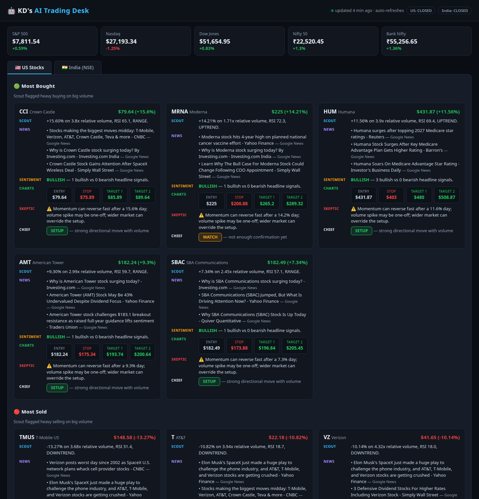
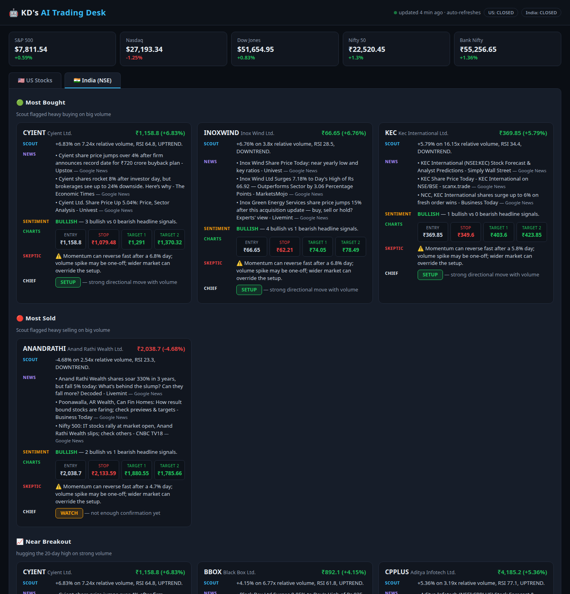
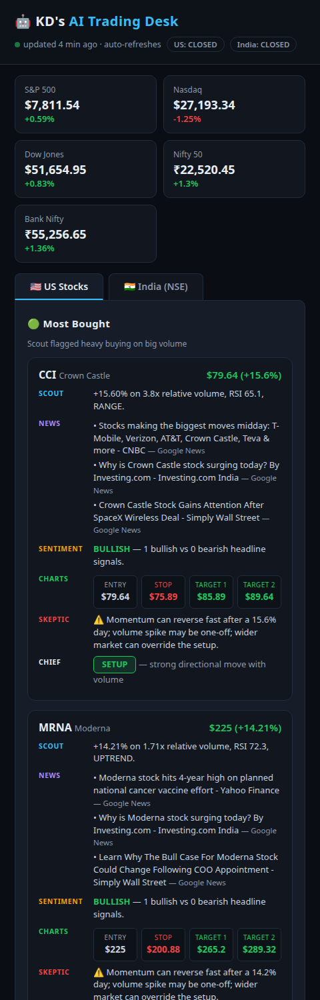
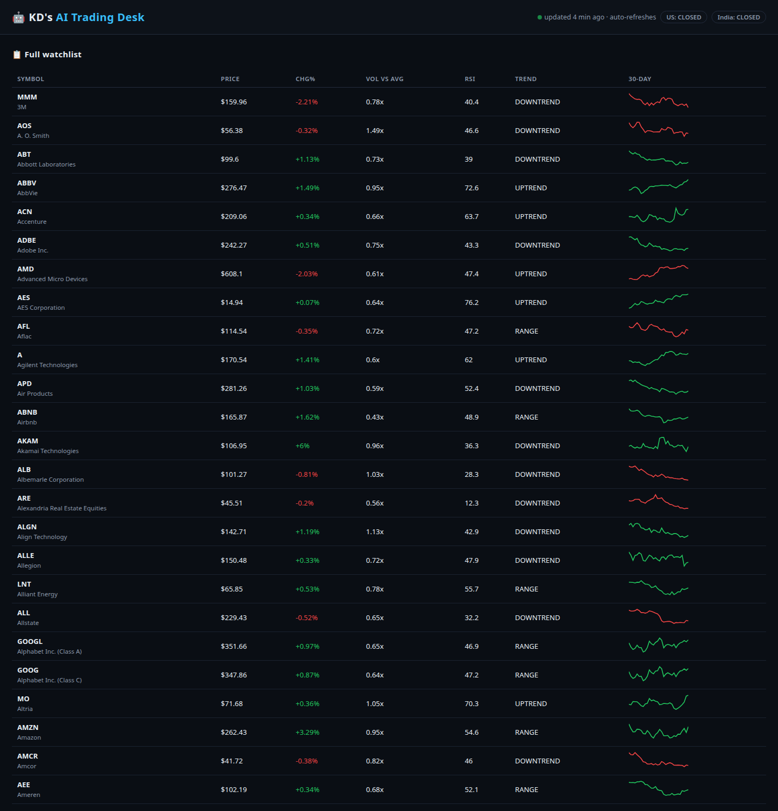

# AI Trading Analysis

**Realtime stock analysis for US & Indian markets — no servers, no Vercel, just GitHub.**

[](https://github.com/karandarjishack/stock-analysis/actions/workflows/update.yml)
[](https://karandarjishack.github.io/stock-analysis/)

### 🔴 Live dashboard → https://karandarjishack.github.io/stock-analysis/

Inspired by the viral AI trading-desk reels: six specialized AI agents screen the market,
debate every pick, and deliver a verdict — automatically, every 15 minutes during market hours.

---

## 📸 Screenshots

| US desk — most bought & sold | India (NSE) desk |
|---|---|
|  |  |

| Six-agent pick card | Full watchlist |
|---|---|
|  |  |

---

## ✨ Features

- **~1,000 stocks screened** — every constituent of the **S&P 500** (US) plus the **Nifty 500** (India, NSE)
- **Six-agent AI desk on every pick** — Scout, News, Sentiment, Charts, Skeptic and Chief (see below)
- **Four live screens** — 🟢 Most Bought · 🔴 Most Sold · 📈 Near Breakout · 📉 Weak / Near Lows
- **Full watchlist** — price, day change, volume vs average, RSI(14), trend and 30-day sparkline for every stock
- **5 index cards** — S&P 500, Nasdaq, Dow Jones, Nifty 50, Bank Nifty with live day change
- **Auto-refresh** — data re-pulls every 15 minutes on weekdays during market hours; the open page checks for fresh data every 5 minutes
- **Smart after-hours mode** — when markets are closed, the dashboard keeps showing the last session's complete stats (e.g. Friday's close) instead of going blank
- **Zero backend** — a static JSON file + a single HTML page on GitHub Pages; free forever

---

## 🧠 The six-agent desk

Every shortlisted stock is analyzed by six agents before it reaches you:

| Agent | Role |
|---|---|
| 🔵 **SCOUT** | Finds the movers — stocks with big directional moves on heavy relative volume |
| 🟣 **NEWS** | Pulls the latest headlines explaining *why* the stock is moving |
| 🟡 **SENTIMENT** | Scores headline tone: bullish / bearish / mixed |
| 🟢 **CHARTS** | Computes entry, stop-loss and two target levels from 14-day ATR |
| 🔴 **SKEPTIC** | Argues *against* the trade — overbought risk, one-off volume, market override |
| ⚪ **CHIEF** | Final verdict: **SETUP** (tradeable) · **WATCH** · **WAIT** · **SKIP** |

---

## 🔍 The screens

| Screen | Rule |
|---|---|
| 🟢 Most Bought | Up ≥ 3% on the day **and** ≥ 1.5× average volume — institutional-style accumulation |
| 🔴 Most Sold | Down ≥ 2.5% on the day **and** ≥ 1.5× average volume — heavy distribution |
| 📈 Near Breakout | Trading within 1.5% of its 60-day high, up ≥ 2% on ≥ 1.3× volume |
| 📉 Weak / Near Lows | Within 1.5% of its 60-day low (or down ≥ 2%) on elevated volume |

"Most bought / most sold" is inferred from **price direction + relative volume** — it is a momentum
proxy, not exchange order-flow data. No free feed provides true buy/sell imbalance.

---

## 🏗️ How it works

```
┌─────────────────────────────┐
│  .github/workflows/update.yml│  every 15 min, Mon–Fri, 04:00–19:00 UTC
└──────────────┬──────────────┘
               ▼
┌─────────────────────────────┐
│  scripts/fetch.py            │
│  • US: Nasdaq official API   │── 503 symbols, daily history
│  • India: NSE bhavcopy files │── 501 symbols, daily OHLCV
│  • 6-agent desk per pick     │── news via Google News RSS
└──────────────┬──────────────┘
               ▼
   docs/data/market.json  (~700 KB, committed to the repo)
               ▼
   docs/index.html  (static page, auto-refreshes every 5 min)
               ▼
   https://karandarjishack.github.io/stock-analysis/
```

- **Fail-safe:** if a run fetches zero symbols, the previous `market.json` is kept — the site never goes blank.
- **Tickers:** the full S&P 500 + Nifty 500 lists live in `docs/data/tickers.json`.
- **Indices:** Nasdaq API (Nasdaq Composite), NSE official index files (Nifty 50, Nifty Bank), Stooq (S&P 500, Dow Jones). If an index feed fails, the last known value is kept.

---

## 📊 Data sources & honesty

All sources are **free, official, and need no API key** — exchange-direct where possible:

- US stocks: Nasdaq official API · India stocks: NSE bhavcopy (nsearchives.nseindia.com)
- News: Google News RSS · Sentiment: headline keyword scoring

**Honest limits:**
- Free market data is **delayed ~15 minutes**. Tick-level realtime needs a paid feed.
- Screens are **momentum + volume proxies**, not order-flow truth.
- This is an **educational screener, not financial advice.** Levels are technical reference only.

---

## 💻 Run locally

```bash
python3 scripts/fetch.py                     # writes docs/data/market.json (~7 min for 1000 stocks)
python3 -m http.server --directory docs 8000 # open http://localhost:8000
```

Requirements: Python 3.10+ (standard library only — no pip packages needed).

## 📁 Project structure

```
ai-trading-analysis/
├── docs/
│   ├── index.html          # the dashboard (single file)
│   ├── screenshots/        # dashboard screenshots
│   └── data/
│       ├── market.json     # latest screener output (auto-updated)
│       └── tickers.json    # S&P 500 + Nifty 500 symbol lists
├── scripts/
│   └── fetch.py            # screener + 6-agent desk pipeline
└── .github/workflows/
    └── update.yml          # refresh every 15 min on weekdays
```

---

*Educational use only — not financial advice.*
